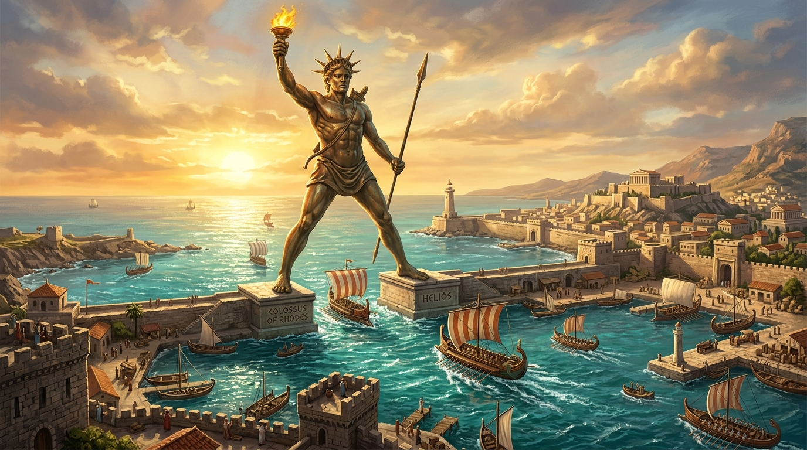

# 🏛️ 7 Wonders - Ancient World Board Game with AI

An authentic, feature-complete web implementation of the award-winning **7 Wonders** civilization board game, playable in any modern browser against intelligent AI opponents.



---

## ✨ Features

- **Full 3-Age Draft Mechanism**:
  - Age I, Age II, and Age III complete card distributions.
  - Authentic card counts and player scaling (3 to 7 players).
  - Accurate rotation directions (Age I & III clockwise to left, Age II counter-clockwise to right).
  - Free building chains (e.g., *Theater* ➔ *Statue*, *Baths* ➔ *Aqueduct*, *Scriptorium* ➔ *Courthouse/Library*).

- **The 7 Wonders of the Ancient World**:
  - **The Colossus of Rhodes** (Military power & ore production)
  - **The Lighthouse of Alexandria** (Trade versatility & wild goods)
  - **The Temple of Artemis in Ephesus** (Treasury wealth & coins)
  - **The Hanging Gardens of Babylon** (Scientific mastery & wild science)
  - **The Statue of Zeus at Olympia** (Free builds per age & guild copying)
  - **The Mausoleum at Halicarnassus** (Discard pile resurrection)
  - **The Great Pyramids of Giza** (Monumental civilian victory points)
  - Both **Side A** and **Side B** asymmetric abilities fully implemented.

- **Intelligent AI Bots with Distinct Archetypes**:
  - **Alexander the Great** (Militaristic warmonger, focuses on shield superiority)
  - **Aristotle** (Science genius, prioritizes matching symbol sets and exponential $k^2$ scoring)
  - **Croesus** (Mercantile oligarch, maximizes gold reserves, commerce cards, and trade posts)
  - **Pericles** (Civic architect, builds prestigious blue monuments and high VP chains)
  - **Imhotep** (Master builder, rushes wonder stages ahead of schedule)
  - **Cleopatra** (Adaptive strategist, opportunist, counter-picker, and hate-drafter)

- **Official Trading System**:
  - Dynamic solver for flexible slash resources (e.g., *Caravansery*, *Forum*).
  - Automatic calculation of cheapest trade path from Left and Right neighbors.
  - Support for commercial discounts (*East/West Trading Posts*, *Marketplace* reducing trade to 1 coin).

- **Complete Scoring Engine**:
  - ⚔️ Military Victory & Defeat tokens (+1, +3, +5 VP for wins, -1 VP for defeats).
  - 🪙 Treasury Points (1 VP per 3 coins).
  - 🌟 Wonder Stage Completion Points.
  - 🏛️ Civilian Structures (Blue cards).
  - 📜 Scientific Structures ($k^2 + 7 \times \text{sets}$ with optimal wild science solver).
  - ⚖️ Commercial Structures (Endgame multipliers and coins).
  - 👑 Guilds (Age III purple cards evaluating neighbor cities).

- **Immersive Visual & Audio Experience**:
  - Handcrafted board game aesthetic with dark marble and gold foil accents.
  - Procedural Web Audio API sound synthesizer (card dealing, construction chime, coin clinks, war horn, and victory fanfares).
  - Toggleable procedural Ancient Lyre ambient musical accompaniment.
  - Interactive Illustrated Rules & Strategy Reference Guide.

---

## 🚀 How to Run Locally

You can run the game using Python's built-in web server or any static file server:

```bash
# 1. Navigate to the game folder
cd 7-wonder-ai

# 2. Start the local server
python -m http.server 8080

# 3. Open your browser at:
# http://localhost:8080/
```

Zero Node.js or external package dependencies required.

---

## 📁 Architecture

```text
7-wonder-ai/
├── index.html              # Main HTML5 entry point and HUD interface
├── assets/
│   └── wonders/            # High-resolution artwork for the 7 Wonders
├── css/
│   ├── main.css            # Design tokens, typography, grid, and HUD styling
│   ├── cards.css           # 3D card layout, foil frames, and affordability badges
│   ├── wonder.css          # Hero wonder board and stage sockets
│   └── modals.css          # Modals for card actions, military arena, and podium
└── js/
    ├── app.js              # Main application coordinator
    ├── audio.js            # Web Audio API sound effects and ancient lyre generator
    ├── data/
    │   ├── cards.js        # Complete Age I, II, III cards & Guilds database
    │   ├── wonders.js      # The 7 Wonders boards with Side A & Side B specs
    │   └── personalities.js # AI player archetypes and strategic weights
    ├── engine/
    │   ├── game.js         # Core game state machine and draft loop
    │   ├── trade.js        # Resource satisfaction and cheapest trade solver
    │   ├── ai.js           # AI evaluation, heuristic valuation, and hate-drafting
    │   └── scoring.js      # Official 7-category scoring calculator
    └── ui/
        ├── render.js       # Dynamic DOM renderer for cards, board, and docks
        └── modals.js       # Modals for military conflicts, scorecard, and rules
```
